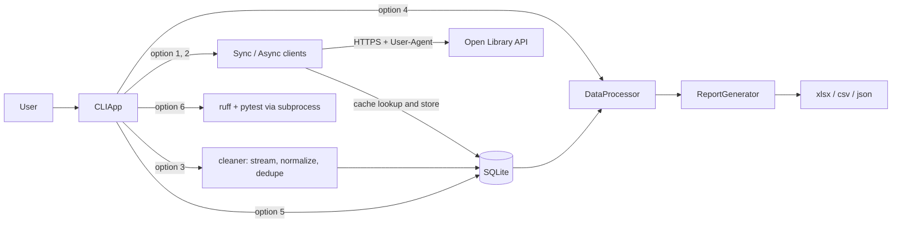

# Open Library Intelligence & Catalog Automation System

[](https://github.com/ire-cr90/CapstoneProject/actions/workflows/ci.yml)


Capstone project for **SOFT-753 Automation with Python** (CENFOTEC), Section SEV8, Period M6-2026.
Instructor: Romario Salas Cerdas.

An object-oriented command line application that ingests book data from the public
[Open Library API](https://openlibrary.org/developers/api), cleans and deduplicates local catalog
files, stores everything in SQLite with a TTL response cache, compares synchronous and asynchronous
HTTP performance, and produces Excel, CSV and JSON reports with pandas and openpyxl.

---

## Table of contents

1. [Features](#features)
2. [Architecture](#architecture)
3. [Requirements](#requirements)
4. [Setup](#setup)
5. [Configuration](#configuration)
6. [Usage](#usage)
7. [Example outputs](#example-outputs)
8. [Testing and linting](#testing-and-linting)
9. [Continuous integration](#continuous-integration)
10. [Open Library API endpoints used](#open-library-api-endpoints-used)
11. [Database schema](#database-schema)
12. [Design decisions](#design-decisions)
13. [Known issues in the original instructions](#known-issues-in-the-original-instructions)

---

## Features

| Area | What it does |
| --- | --- |
| **API clients** | `SyncLibraryClient` (`httpx.Client`) and `AsyncLibraryClient` (`httpx.AsyncClient`) with the same public methods, a descriptive `User-Agent`, exponential backoff retries for timeouts, connection errors and 5xx, `Retry-After` handling for HTTP 429, a client-side requests-per-second throttle and an `asyncio.Semaphore` concurrency limit. |
| **Error handling** | A custom exception hierarchy (`LibraryAppError` → `APIError`, `RateLimitError`, `NotFoundError`, `DataValidationError`, `DatabaseError`, `ConfigurationError`, `ReportGenerationError`) mapped to friendly CLI messages. Nothing crashes the menu loop. |
| **SQLite persistence** | `DatabaseManager` with `works`, `authors`, `work_authors`, `api_cache`, `cache_stats` and `benchmarks` tables, `INSERT ... ON CONFLICT DO UPDATE` upserts, `executemany` batch transactions with rollback, foreign keys and WAL journaling. |
| **TTL cache** | API responses are cached by a SHA-256 key of method + URL + parameters, expire after `CACHE_TTL_HOURS`, and the hit/miss counters are persisted so the hit ratio survives restarts. |
| **Data cleaning** | Unicode NFC normalization, BOM and control character removal, regex input sanitizing, subject slugs, ISBN-10/ISBN-13 extraction and checksum validation, a custom streaming generator for CSV / JSON / JSON Lines and set-based deduplication. |
| **Analytics** | `DataProcessor` (pandas) handles missing values, year and timestamp parsing, decades, joins through `work_authors`, top years, languages, authors and subjects, average edition count, benchmark summary and KPIs. |
| **Reports** | `ReportGenerator` writes a styled multi-sheet Excel workbook with a bar chart, a CSV summary and a minified JSON export ready for API handoff. |
| **Performance** | Option 1 times the same subject pages with both clients using `time.perf_counter()`, shows the speedup and stores every run for the Excel report. |
| **Quality** | 136 offline tests (95% coverage), Ruff lint and format, GitHub Actions CI, and a menu option that runs the whole quality suite with `subprocess`. |

---

## Architecture

```
library-project/
├── .github/workflows/ci.yml      GitHub Actions: ruff check, ruff format --check, pytest
├── data/
│   ├── sample_catalog.csv        Intentionally dirty catalog used by option 3
│   └── outputs/                  Generated reports (kept with .gitkeep, contents ignored)
├── src/
│   ├── config.py                 Settings (pydantic-settings) + get_settings / reload_settings
│   ├── exceptions.py             Custom exception hierarchy
│   ├── logger.py                 Console + rotating file logging, configured once
│   ├── api/
│   │   ├── sync_client.py        SyncLibraryClient, RetryPolicy, cache key and request helpers
│   │   └── async_client.py       AsyncLibraryClient with semaphore and asyncio.gather pages
│   ├── db/
│   │   └── manager.py            DatabaseManager: schema, upserts, batches, cache, searches, metrics
│   ├── processing/
│   │   ├── cleaner.py            Pure cleaning functions, ISBN logic, streaming generator, dedup
│   │   └── analytics.py          DataProcessor: pandas preparation, joins, aggregations, KPIs
│   ├── reporting/
│   │   └── generator.py          ReportGenerator: Excel (openpyxl), CSV summary, minified JSON
│   └── cli/
│       └── menu.py               CLIApp, ProgressBar, Spinner, table formatting
├── tests/                        api, cleaner, db, analytics, cli and config tests
├── .env.example                  Every configuration key with safe defaults
├── pyproject.toml                Dependencies, pytest and Ruff configuration
└── main.py                       Entry point: CLIApp().run()
```

### Module responsibilities

- **`src/config.py`**: `Settings(BaseSettings)` reads environment variables and `.env`, with typed
  defaults so the app, the tests and CI run without a `.env` file. Validators reject a negative
  `MAX_RETRIES`, unknown log levels, non-HTTP base URLs and an empty `USER_AGENT`.
  `reload_settings()` clears the cached instance after option 5 changes a value.
- **`src/exceptions.py`**: one base class (`LibraryAppError`) so the CLI can catch every
  application error in one place. `APIError` carries `status_code` and `url`, and `RateLimitError`
  adds `retry_after`.
- **`src/logger.py`**: `get_logger(name)` attaches a console handler and a `RotatingFileHandler`
  (1 MB, 3 backups) to the `library` logger only once.
- **`src/api/`**: both clients share one `RetryPolicy`, so the sync and async retry rules are
  identical. `fetch_subject_pages` returns one `PageResult` per page, so a failed page never
  hides the successful ones.
- **`src/db/manager.py`**: every SQL statement of the project lives here, always parameterized.
- **`src/processing/cleaner.py`**: pure functions that are easy to test, plus the mappers from
  API JSON to database records.
- **`src/processing/analytics.py`**: turns database rows into DataFrames and computes everything
  the reports show.
- **`src/reporting/generator.py`**: formatting only. It receives a `DataProcessor` and writes files.
- **`src/cli/menu.py`**: the only module that talks to the user. It wires all the others together.

### Data flow



---

## Requirements

- Python **3.13**
- [uv](https://docs.astral.sh/uv/) 0.13 or newer (all commands below use `uv`, never `pip`)
- Internet access for options 1 and 2 (everything else, including the tests, works offline)

Runtime dependencies: `httpx`, `pandas`, `openpyxl`, `python-dotenv` and `pydantic-settings`.
Development dependencies: `pytest`, `pytest-asyncio`, `pytest-mock`, `pytest-cov` and `ruff`.

> **Note:** `pydantic-settings` was missing from the dependency list in the original instructions
> even though `config.py` must use `pydantic_settings.BaseSettings`. It is included here.

---

## Setup

```bash
git clone https://github.com/ire-cr90/CapstoneProject.git
cd CapstoneProject
uv sync
cp .env.example .env
```

On Windows PowerShell use `Copy-Item .env.example .env` instead of `cp`.

Then edit `.env` and put your own contact email in `USER_AGENT`. Open Library asks API clients to
identify themselves with a way to contact them.

---

## Configuration

Every key is optional. The defaults below are used when a key is missing from `.env`.

| Key | Default | Description |
| --- | --- | --- |
| `API_BASE_URL` | `https://openlibrary.org` | Base URL of the API |
| `REQUEST_TIMEOUT` | `10.0` | Seconds before a request times out |
| `MAX_RETRIES` | `3` | Retries after the first attempt (must be >= 0) |
| `BACKOFF_FACTOR` | `0.5` | Backoff base: waits 0.5 s, 1 s, 2 s, ... |
| `MAX_CONCURRENCY` | `5` | Maximum simultaneous async requests (1 to 50) |
| `REQUESTS_PER_SECOND` | `3.0` | Client-side throttle shared by all requests of a client |
| `CACHE_TTL_HOURS` | `24` | Lifetime of a cached API response |
| `DB_PATH` | `data/library.db` | SQLite database file |
| `OUTPUT_DIR` | `data/outputs` | Folder for generated reports |
| `LOG_LEVEL` | `INFO` | `DEBUG`, `INFO`, `WARNING`, `ERROR` or `CRITICAL` |
| `LOG_FILE` | `library.log` | Rotating log file |
| `USER_AGENT` | `OpenLibraryCapstone/1.0 (contact: your-email@example.com)` | Sent with every request |

Values can also be changed at runtime from option 5 → 4.

---

## Usage

```bash
uv run python main.py
```

```
======================================================================
        OPEN LIBRARY INTELLIGENCE & CATALOG AUTOMATION SYSTEM
======================================================================
[1] Ingest Works by Subject
[2] Search Books by Author/Title/ISBN
[3] Process & Deduplicate Local Catalog File
[4] Generate Analytical Reports
[5] System Health, Cache Maintenance & Database Administration
[6] Run Quality Checks & Test Suite Diagnostic
[0] Exit
======================================================================
Select an option:
```

Every prompt validates its input and asks again (up to three times) on invalid answers.
`Ctrl+C` inside an option cancels it and returns to the menu; at the main prompt it exits cleanly.

### [1] Ingest Works by Subject

1. Asks for a subject (cleaned with a regex and converted to an Open Library slug, for example
   `Science Fiction!` → `science_fiction`) and a page depth from 1 to 10.
2. Fetches the same pages (50 works each) with `SyncLibraryClient` one by one and with
   `AsyncLibraryClient` concurrently, showing a progress bar for each and timing both with
   `time.perf_counter()`.
3. Prints a comparison table (seconds, pages OK, works fetched) and the speedup.
4. Upserts the works, their authors and the links in one batch transaction, caches every response
   and stores the benchmark run.

### [2] Search Books by Author/Title/ISBN

A submenu lets you search by author, title or ISBN, or auto-detect the query type. ISBNs are
checked with the ISBN-10 / ISBN-13 checksum and rejected if invalid. ISBN-10 and ISBN-13 forms of
the same book are treated as equivalent.

Lookup order: **SQLite first**, then the **API cache**, then the **Search API**. API results are
cached and upserted, so the next identical search comes from the database. The results table shows
title, authors, year, languages and ISBN, plus the source (`database`, `cache` or `API`).

Database searches are accent- and case-insensitive: `garcia marquez` finds
`Gabriel García Márquez`.

### [3] Process & Deduplicate Local Catalog File

Asks for a path (default `data/sample_catalog.csv`; `.csv`, `.json` and `.jsonl` are accepted),
streams the file with a generator, normalizes every field, deduplicates with a set and upserts in
batches of 200. The summary shows rows read, invalid rows, invalid ISBNs, duplicates removed and
rows inserted or updated.

### [4] Generate Analytical Reports

Runs `DataProcessor` over the database and writes three files to `data/outputs/`:

| File | Contents |
| --- | --- |
| `library_report_YYYYMMDD.xlsx` | Sheets **Summary** (KPIs, missing values, performance), **Works**, **Top Years** (with a bar chart), **Languages**, **Authors**, **Subjects** and **Benchmarks**. Styled headers, auto column widths, frozen header row, autofilter and number formats. |
| `library_summary_YYYYMMDD.csv` | `category,value,count` rows for the top publication years and languages |
| `library_export_YYYYMMDD.json` | Minified JSON (`separators=(",", ":")`, `ensure_ascii=False`) with metadata (generated_at, record counts, KPIs, missing values) and the cleaned records |

### [5] System Health, Cache Maintenance & Database Administration

1. Database metrics: row counts per table, database, WAL and total file size, page-based size,
   cache hits, misses, hit ratio and expired entries
2. Purge expired cache entries
3. Show the current configuration (the contact email is partially hidden, for example `y***@example.com`)
4. Change a `.env` value at runtime: the key must exist in `Settings`, the value is validated,
   written with `python-dotenv`'s `set_key` and the settings are reloaded
5. Back

### [6] Run Quality Checks & Test Suite Diagnostic

Runs, with `subprocess.run` and no `shell=True`, and prints the output and exit code of each:

1. `uv run ruff check .`
2. `uv format --check` (falls back to `uv run ruff format --check .` when the installed uv does not
   have the `format` command)
3. `uv run pytest -q`

It finishes with a PASS / FAIL summary.

---

## Example outputs

Real output from a run against the live API (Windows 11, Python 3.13).

**Option 3** with the sample catalog:

```
Metric                | Value
----------------------+------
Rows read             |    37
Invalid rows skipped  |     3
Invalid ISBNs dropped |     2
Duplicates removed    |     9
Unique records        |    25
Rows inserted         |    25
Rows updated          |     0
```

**Option 1** with subject `science fiction` and 2 pages:

```
Mode  | Seconds | Pages OK | Works fetched
------+---------+----------+--------------
Sync  |   1.702 | 2/2      |           100
Async |   1.177 | 2/2      |           100
Speedup: async was 1.45x the speed of sync.
Saved 100 unique works with their authors. Responses were cached.
```

**Option 2** by ISBN `0-441-17271-7` (an ISBN-10 that matches a work stored with its ISBN-13):

```
Source: database | 1 result(s)
Title | Authors       | Year | Languages | ISBN
------+---------------+------+-----------+--------------
Dune  | Frank Herbert | 1965 | eng       | 9780441172719
```

**Option 4** KPIs:

```
KPI                   | Value
----------------------+-------
total_works           |    125
total_authors         |     87
unique_languages      |      5
oldest_year           |   1605
newest_year           |   2011
average_edition_count | 315.06
cache_hit_ratio       |    0.0
average_async_speedup | 1.4461
data_completeness_pct |   73.2
```

**Option 6**:

```
Check        | Exit code | Result
-------------+-----------+-------
Ruff lint    |         0 | PASS
Format check |         0 | PASS
Tests        |         0 | PASS
ALL CHECKS PASSED (3/3)
```

---

## Testing and linting

```bash
uv run ruff check .
uv run ruff format .
uv run pytest -v
uv run pytest --cov=src --cov-report=term-missing
```

No test touches the real network: HTTP is mocked with `unittest.mock` (`patch`, `MagicMock`,
`AsyncMock`), `time.sleep` / `asyncio.sleep` are patched so retries are instant, and every file
and database lives in pytest's `tmp_path`.

| Test file | Covers |
| --- | --- |
| `tests/api_test.py` | Success, User-Agent header, 404 → `NotFoundError`, 5xx retry then success, 429 with `Retry-After`, retries exhausted → `APIError` / `RateLimitError`, timeouts, invalid JSON, cache hits, async concurrency limit and page order, per-page errors and progress callbacks |
| `tests/cleaner_test.py` | Valid and invalid ISBN-10 / ISBN-13 (including `X`), extraction from messy text, 10 ↔ 13 conversion, BOM / NFC / whitespace normalization, slugs, input cleaning errors, query type detection, CSV / JSON / JSON Lines streaming and set deduplication |
| `tests/db_test.py` | Table creation, pragmas, upsert insert and update, batch transaction and rollback, TTL expiry and purge, persistent hit/miss counters, searches (including SQL injection and LIKE wildcard attempts) and metrics |
| `tests/analytics_test.py` | Missing values, date parsing, joins, groupings, KPIs, empty databases, plus the report generator: three files, Excel formatting and chart, CSV columns and minified JSON |
| `tests/cli_test.py` | Menu layout, invalid options, `Ctrl+C`, error handling and all six options with scripted input and mocked clients |
| `tests/config_test.py` | Defaults without `.env`, validators and `reload_settings` |

Coverage (136 tests):

| Module | Coverage |
| --- | --- |
| `src/api/async_client.py` | 88% |
| `src/api/sync_client.py` | 96% |
| `src/cli/menu.py` | 95% |
| `src/config.py` | 100% |
| `src/db/manager.py` | 97% |
| `src/exceptions.py` | 100% |
| `src/logger.py` | 86% |
| `src/processing/analytics.py` | 97% |
| `src/processing/cleaner.py` | 99% |
| `src/reporting/generator.py` | 94% |
| **Total** | **95%** |

---

## Continuous integration

`.github/workflows/ci.yml` runs on every `push` and `pull_request`:

1. `actions/checkout@v4`
2. `astral-sh/setup-uv@v6` with uv `0.13.1` pinned and caching enabled
3. `uv sync --all-groups`
4. `uv run ruff check .`
5. `uv run ruff format --check .`
6. `uv run pytest -v`

The `main` branch is protected: changes arrive through pull requests and the CI check must pass
before merging.

---

## Open Library API endpoints used

The JSON field names were checked against live responses before writing the clients.

| Method | Endpoint | Used for |
| --- | --- | --- |
| `search(query, page, by="q")` | `GET /search.json?q={query}&page={page}` | Free-text search |
| `search(query, by="title" \| "author")` | `GET /search.json?title=...` / `?author=...` | Option 2 title and author searches |
| `search_isbn(isbn)` | `GET /search.json?isbn={isbn}` | Option 2 ISBN searches |
| `get_work(work_id)` | `GET /works/{work_id}.json` | Work details |
| `get_author_works(author_id, limit, offset)` | `GET /authors/{author_id}/works.json` | Works by an author |
| `get_subject(subject, limit, offset)` | `GET /subjects/{subject}.json?limit=&offset=` | Option 1 ingestion |
| `fetch_subject_pages(subject, pages, limit)` | Several `/subjects/` pages | Sequential (sync) or concurrent (async) |

Search requests send `fields=key,title,author_name,author_key,first_publish_year,language,isbn,edition_count,subject`
so Open Library only returns what the app stores.

---

## Database schema

| Table | Key columns | Purpose |
| --- | --- | --- |
| `works` | `work_key` PK, `title`, `normalized_title`, `first_publish_year`, `languages` / `isbns` / `subjects` (JSON lists), `edition_count`, `source` (`api` / `catalog`), `created_at`, `updated_at` | One row per work |
| `authors` | `author_key` PK, `name`, `normalized_name`, `updated_at` | One row per author |
| `work_authors` | (`work_key`, `author_key`) composite PK, both foreign keys with `ON DELETE CASCADE` | **Extra table** linking works and authors, needed for the joins in the analytics |
| `api_cache` | `cache_key` PK (SHA-256 of method + URL + params), `url`, `response_json`, `created_at`, `expires_at`, `hit_count` | TTL response cache |
| `cache_stats` | `stat` PK (`hits`, `misses`), `value` | Persistent cache counters |
| `benchmarks` | `id`, `subject`, `pages`, `sync_seconds`, `async_seconds`, `speedup`, `works_count`, `run_at` | Sync vs async runs for the performance metrics |

---

## Design decisions

Choices the instructions did not cover, and why:

**Project setup**

- **No build backend in `pyproject.toml`.** This is an application, not a library, so uv treats
  it as a virtual project and the code is imported as `src.*` from the project root
  (`pythonpath = ["."]` for pytest).
- **Extra test files.** `tests/cli_test.py` and `tests/config_test.py` were added on top of the four
  required files so every module is tested.
- **`pytest-cov`** was added (optional in the instructions) to measure and report coverage.

**API clients**

- **Shared `RetryPolicy`.** The sync and async clients use the same object to decide when to retry,
  how long to wait and which exception to raise, so their behavior cannot drift apart.
- **Backoff.** The wait is `BACKOFF_FACTOR * 2^(attempt - 1)`. `Retry-After` accepts seconds or an
  HTTP date and is capped at 60 seconds so a bad header cannot freeze the app.
- **`refresh=True` for benchmarks.** Option 1 skips cache reads for both clients so the timing
  compares real network calls, but the fresh responses are still written to the cache. Without
  this, the async run would read what the sync run had just cached and the comparison would be
  meaningless.
- **`PageResult` per page.** Both clients return one result per page (data or error) and accept a
  progress callback, which feeds the progress bars and keeps failed pages from hiding the rest.
- **`fields` parameter on searches** limits the response to the stored columns, which is lighter
  for Open Library.
- **Cache errors never break a request.** A failing cache read counts as a miss and a failing write
  is logged.

**Database**

- **Upserts keep existing data.** An update with a missing year, edition count or an empty list
  keeps the stored value, because the subject endpoint returns no languages and would otherwise
  erase what a search had saved.
- **Accent-insensitive search columns.** `normalized_title` and `normalized_name` are stored
  without accents and in lowercase, so searches work regardless of how users type names.
- **LIKE wildcards are escaped** so `%` or `_` typed by a user match literally.
- **ISBN search uses `json_each`** over the JSON list column, with parameters only.
- **Timestamps are ISO 8601 UTC strings**, which sort correctly as text and make TTL comparisons simple.
- **Storage metrics include the WAL file**, because in WAL mode new data stays in
  `library.db-wal` until SQLite checkpoints it.
- **Injectable clock.** `DatabaseManager` and `ReportGenerator` accept a clock so expiry and file
  names can be tested without waiting.

**Cleaning and analytics**

- **Invalid ISBNs are dropped, not the whole row.** A row with a valid title but a bad checksum is
  still useful, and the dropped ISBNs are counted in the summary.
- **Dedup key.** The ISBN-13 when any valid ISBN exists (ISBN-10s are converted first), otherwise
  the accent-insensitive title plus first author, exactly as the instructions describe.
- **Catalog keys** are stable hashes (`CAT-…` for works, `CAT-A-…` for authors), so importing the
  same file twice updates rows instead of duplicating them.
- **Year 0 and impossible years are missing values.** Open Library returns `first_publish_year: 0`
  for some works. Years below 1 or after next year are treated as missing.
- **Missing languages count as `und`** (the ISO 639-2 code for "undetermined") in the language
  ranking, so the gap is visible in the report, and they are still flagged as missing.
- **Subjects are capped at 25 per work**, since popular books list hundreds.
- **Query type detection** is a simple rule: something that looks like an ISBN is an ISBN, and 2 to
  4 capitalised words without title words such as "the" or "of" are an author. The submenu also lets
  the user choose explicitly.
- **Data completeness** is the share of six key fields that are filled: title, year, languages,
  ISBNs, edition count and authors.

**Reports**

- **File names.** The Excel name follows the instructions. The CSV and JSON files are named
  `library_summary_YYYYMMDD.csv` and `library_export_YYYYMMDD.json`.
- **Top 15** rows are shown in the ranking sheets, while the Works sheet lists every work.
- **Excel timestamps are written in UTC without a time zone**, because Excel cannot store one.

**CLI**

- **Three attempts per prompt**, then the option returns to the menu instead of looping forever.
- **Auto-detect** is offered as a fourth choice in the option 2 submenu.
- **Console logging shows warnings and errors only**, so the menu stays readable. The log file
  records everything at `LOG_LEVEL`. Skipped catalog rows are logged at INFO because the summary
  already counts them.
- **Changing a setting** validates the whole configuration first, writes with `set_key`, reloads
  the settings, reopens the database if `DB_PATH` changed and warns if an environment variable
  overrides `.env`.
- **The sample catalog** has 37 rows. A script computed the ISBN check digits, so the valid ISBNs
  match real books and the two invalid ones fail on purpose.

---

## Known issues in the original instructions

| Issue | How it was handled |
| --- | --- |
| The suggested branch name `feature/banking` was left over from the banking lab | The work was done on `feature/open-library` |
| `pydantic-settings` was missing from the dependency list | Installed with `uv add pydantic-settings`, since `config.py` uses `BaseSettings` |
| `uv format --check` is a newer uv command | Option 6 tries it first and falls back to `uv run ruff format --check .` when uv reports an unrecognized subcommand. CI uses `uv run ruff format --check .` directly |
| Rubric rows 4 and 5 are duplicated ("Code Quality, Professional Style, and Documentation") | Code quality and documentation got extra care: type hints and docstrings everywhere, Ruff clean, 95% coverage and this README |
| Typo "performace" | Read as "performance" |
